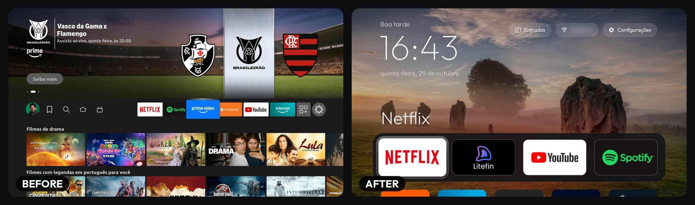
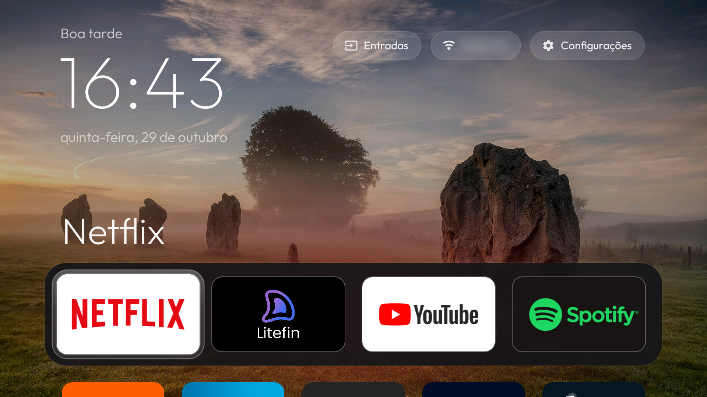
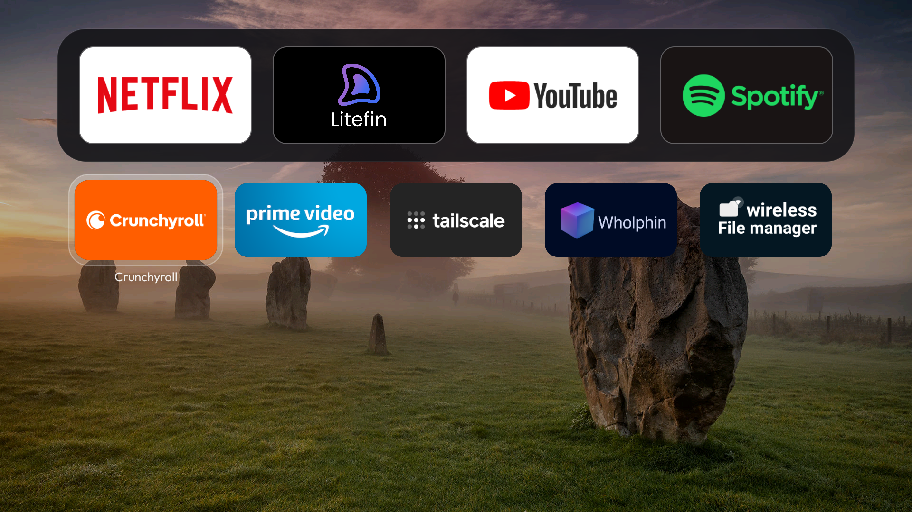
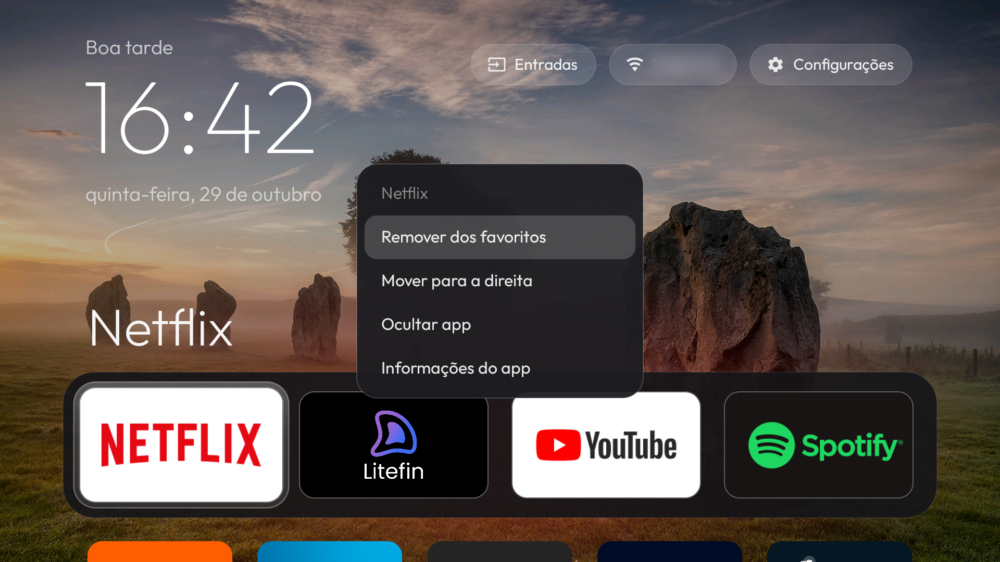
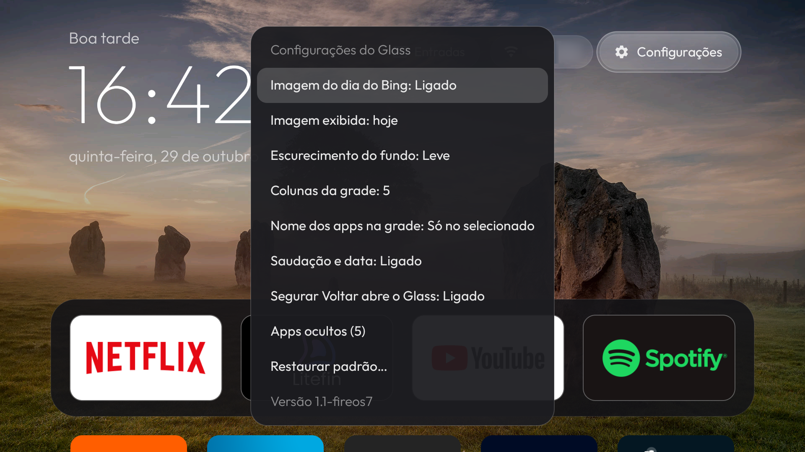

# Fire TV Glass (Fire OS 7 fork)

**Your Fire TV, minus the ads and the tracking.**

Glass is a small, fast home screen for the Fire TV Stick, plus scripts that switch off
Amazon's telemetry, ad and preloaded packages over Wi-Fi. No root, nothing to sideload by
hand.

This is a fork of [ivantrj/firetv-glass-launcher](https://github.com/ivantrj/firetv-glass-launcher)
(Fire OS 8, macOS). It adds:

- **Fire OS 7 support** (Android 9 / API 28), tested on a Fire TV Stick HD.
- **Windows scripts** (PowerShell) next to the original macOS ones.
- **Hold Back to go home instantly**, and a black cover that hides the Amazon home screen while
  Glass comes back after Home.
- **In-app settings**: favourites, hidden apps, Bing image of the day as wallpaper, grid columns
  and more, all from the remote. No more `configure.sh` for day-to-day changes.
- **Portuguese translation** (the UI follows the system language; English otherwise).
- A tidier dock: one big title, no duplicate labels, a band that fits the favourites, a thin
  outline so grey banners don't melt into it.

[](docs/before-after.jpg)

**Everything is reversible.** Packages are disabled with `pm disable-user`, never uninstalled.
The restore scripts turn everything back on and give Home back to Amazon's launcher.

## Quick start

### 1. On the TV

1. Go to **Settings > My Fire TV > About** and click your device's name **7 times**.
   You'll see "You are now a developer".
2. Go back to **Settings > My Fire TV > Developer Options** and turn on **ADB debugging**.

### 2. Build the launcher

Install [Android Studio](https://developer.android.com/studio), open the **`launcher/`** folder
(not the repo root) and use **Build > Build APK(s)**. The APK lands in
`launcher/app/build/outputs/apk/debug/app-debug.apk`.

### 3a. Windows

Open PowerShell in the `windows/` folder. The scripts come from the internet, so allow them
for this window first:

```powershell
Get-ChildItem *.ps1 | Unblock-File
Set-ExecutionPolicy -Scope Process Bypass
```

Then:

```powershell
.\setup.ps1              # finds adb (or downloads Google's platform-tools), asks for the TV's IP
.\debloat.ps1 -DryRun    # shows what would be disabled, changes nothing
.\debloat.ps1            # disables the packages (backs up the current state first)
.\install.ps1            # installs Glass and makes it the home screen
```

When the TV asks **Allow USB debugging?**, tick **Always allow** and choose **OK**.
The scripts' messages are in Portuguese.

| Script | What it does |
|---|---|
| `setup.ps1` | One-time setup: adb, TV IP, connection test |
| `debloat.ps1` | Disables everything in `debloat/disable-list.txt`; logs what it changed to `disabled-by-script.txt` and saves a backup in `backup/` |
| `install.ps1` | Installs the built APK and runs `set-home.ps1 -Launcher glass` |
| `set-home.ps1` | Makes a launcher the home screen through its accessibility service (`glass`, `projectivy`, or any package with `-ServiceComponent`). Only one launcher redirects at a time |
| `restore.ps1` | Undoes it: `-HomeOnly`, `-PackagesOnly`, `-Package <name>`, or `-All` for the whole list. By default it re-enables only what `debloat.ps1` disabled |
| `tv.ps1` | adb shortcut for the saved TV: `.\tv.ps1 shell '...'`, `.\tv.ps1 reboot`, `.\tv.ps1 disconnect` |
| `diag-home.ps1` | Live log of Glass's Home redirect (`GlassDiag`), for troubleshooting |

A `windows/disable-list.txt`, if present, takes precedence over the shared list.

### 3b. macOS

The original scripts still work (see the upstream README for details):

```bash
./setup.sh      # TV helper, TV IP, connection check
./debloat.sh    # disable the packages
./install.sh    # build, install and make Glass the home screen
./restore.sh    # undo
```

### When you're done

Turn **ADB debugging** off again on the TV (and `.\tv.ps1 disconnect` on Windows). While it's on,
anything on your network can try to connect to the TV on port 5555.

## What gets disabled

Full list with comments in [`debloat/disable-list.txt`](debloat/disable-list.txt). Edit it
before running the debloat if you want to keep something. **Review the "Your choices" section**:
it disables HBO Max, Live TV, Amazon Music and Photos, phone casting (Fling/DIAL: the cast button
in YouTube, Netflix, Prime Video), Miracast mirroring and the forced updater.

- **Telemetry:** Minerva metrics, device logger, telemetry emitter, wireless metrics,
  perf collection, ACR (content recognition).
- **Content and ads:** recommendations, the sponsored screensaver (`kso.blackbird`),
  ad-ID service, shopping, miniTV, Ambient Experience, sneak-peek previews.
- **Background:** sharing proxy, Kindle connect, phone sign-in companion,
  print and pro-tips stubs.
- **Preloaded:** tutorials, Amazon Kids, game hub, website launcher.

Fire OS refuses to disable a few "protected" packages (marked in the list). The list was made
on Fire OS 8; on Fire OS 7 six of its packages don't exist and are simply skipped. A Fire OS
update may switch things back on: run the debloat again.

## The launcher

[](docs/home.png)

- **Top bar:** clock, greeting and date, Inputs, Wi-Fi and Settings.
- **Dock:** up to four favourites. The big title and the background glow follow the focused app;
  the title only shows while the dock is focused.
- **Grid:** every other app, alphabetical, 4 or 5 columns. Press Down from the dock.
- **D-pad:** Up and Down always move exactly one row, and the ends of a row never jump elsewhere.
- **Back** returns to the dock. Remembers the last focused tile when you come back from an app.
- Native Java + RecyclerView: about a 4 MB APK.

[](docs/grid.png)

### Menu button (☰) on an app

[](docs/options.png)

| Focused on | Options |
|---|---|
| A grid app | Add to favourites · Hide app · App info |
| A favourite | Remove from favourites · Move left / right · Hide app · App info |

### Settings button

Opens **Fire TV settings** or **Glass settings**:

[](docs/settings.png)

| Glass setting | |
|---|---|
| Bing image of the day | Wallpaper from Bing (off by default). Refreshed daily |
| Image shown | Today, or any of the previous 7 days |
| Background dimming | Light, medium or strong, for any wallpaper |
| Grid columns | 4, or 5 with smaller tiles |
| App names in the grid | Always, or only on the selected app |
| Greeting and date | Show or hide them above the clock |
| Hold Back to open Glass | See below |
| Hidden apps | Select one to show it again, or show all |
| Restore defaults… | Favourites, hidden apps and Glass settings back to defaults (asks first) |

Favourites and hidden apps are stored in `dock.txt` / `hidden.txt` in the app's files folder,
the same files `configure.sh` writes, so both ways keep working. `configure.sh wallpaper` still
sets a manual wallpaper, used when the Bing option is off.

### Privacy

Glass asks for the **internet permission only for the Bing wallpaper**. With that option off
(the default) it makes no network requests; with it on, it only talks to `www.bing.com`.
Location permission is used only to show the Wi-Fi network name (Android requires it).

## How the Home redirect works, and its limits

Fire OS protects its launcher: it can't be disabled, and `set-home-activity` is accepted but
ignored. So Glass includes an accessibility service ("Glass Home button", switched on by
`install.ps1` / `install.sh`). What we measured on Fire OS 7:

- **Fire OS never passes the Home key to accessibility services** (other keys, like Back and the
  D-pad, do arrive). The service can only react once the Amazon home screen appears.
- **After Home, Android blocks background apps from opening screens for up to ~5 s** (the "app
  switch" lockout), and only system apps can bypass it. So after Home, Glass reappears about
  3 s later on a Fire TV Stick HD. Projectivy shows the same delay; any no-root launcher is
  subject to it.
- To make that wait less jarring, the service **covers the Amazon home screen with black** the
  moment it appears and swallows key presses until Glass is back (6 s at most).
- **Hold Back for half a second** in any app to go to Glass instantly: Back doesn't trigger the
  lockout. A short press still works as a normal Back (delivered on release). Can be turned off
  in Glass settings.
- Only the Amazon **home screen** is redirected. Fire OS 7 shows Settings inside the same
  launcher package, so Glass's Settings button opens the launcher's `MainSettingsActivity`
  directly (the standard settings intent would bounce through the Amazon home screen).

While the service is on you can't reach the Amazon home screen. Turn it off with
`restore.ps1 -HomeOnly` / `restore.sh`, or in **Settings > Accessibility**.

Some other gotchas:

- **One `pm` command per call.** Chaining `pm` commands in one shell call can silently stop after
  the first, so every script runs them one at a time.
- **Why not `adb` on macOS.** The stock `adb` can get "No route to host" because of macOS Local
  Network privacy, so the macOS scripts use `tools/tv` (the `adb-shell` Python package) instead.
  On Windows the regular `adb.exe` works fine.

## Tested on

| Device | Fire OS | Notes |
|---|---|---|
| Fire TV Stick HD (AFTSS) | Fire OS 7.7.1.7 (Android 9, API 28) | This fork |
| Fire TV Stick 4K (AFTKRT) | Fire OS 8 (Android 11, API 30) | Upstream |

## Related

Built in the spirit of [CleanYourTV](https://github.com/Gathin23/cleanyourtv), which does the
same for Android TV and Google TV sets.

## License

MIT, see [LICENSE](LICENSE). The **Outfit** font is © The Outfit Project Authors, SIL Open
Font License 1.1 ([`OFL.txt`](launcher/app/src/main/assets/fonts/OFL.txt)).
